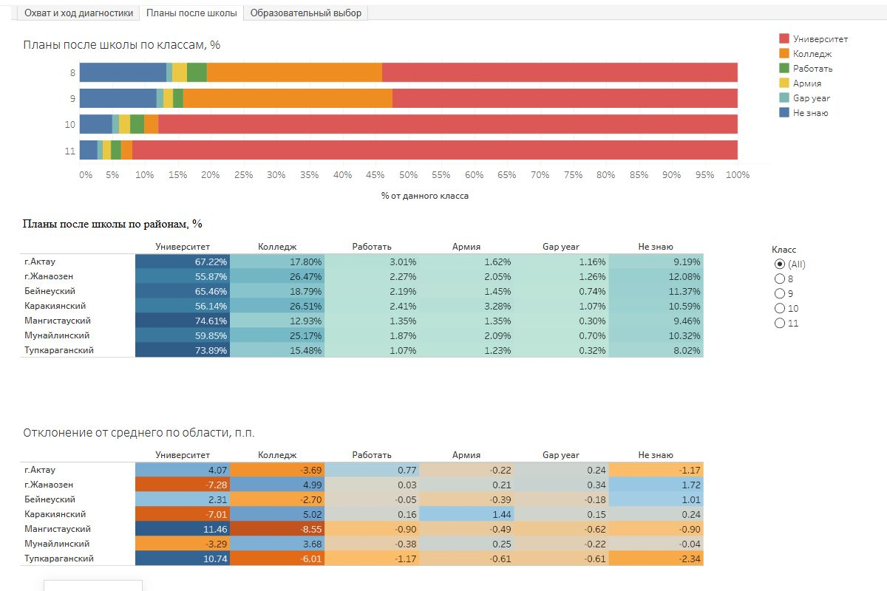

[← Вернуться к портфолио](../../README_Ru.md) | [English version](README.md)

# STEPPE Navigator — аналитика профориентации в Мангистауской области

Интерактивный BI-проект на данных регионального пилота по профориентации, проходившего в Мангистауской области Казахстана с марта по май 2026 года.

Аналитическая выборка содержит завершённые сессии опросника **40 168 учащихся из 148 государственных школ**.

<picture>
  
</picture>

[Открыть интерактивные дашборды на Tableau Public](https://public.tableau.com/app/profile/evgeny.vinogradov/viz/SteppeNavigator_Mangistauresults2026/sheet0_1)

Дашборды представлены на русском языке, поскольку они используют язык и терминологию региональных стейкхолдеров системы образования и исходного опросника.

## Бизнес-контекст

STEPPE Navigator — профориентационная платформа, задуманная как инструмент школьного педагога-профориентатора. Во время пилота прошедшие обучение сотрудники участвовавших государственных школ использовали платформу для диагностики учащихся в Мангистауской области.

Первоначальная аналитика создавалась как часть отчётности по пилоту, а её результаты демонстрировались представителям системы образования. Опубликованный здесь workbook Tableau был разработан позднее как портфолио-демонстрация и в тех презентациях не использовался.

Данные пилота позволяют исследовать четыре управленческих вопроса:

- как проходила профориентационная диагностика в разных районах и классах;
- как образовательные планы учащихся различались по территориям и классам;
- насколько учащиеся определились с образовательным выбором;
- что предполагаемая география обучения может сообщить о потенциальной образовательной миграции.

При переходе от пилота к регулярной работе эти же аналитические представления можно обновлять с начала полугодия или учебного года и использовать как инструмент мониторинга.

## Аналитические вопросы

Опубликованное решение помогает исследовать:

- Сколько учащихся и школ участвовало в каждом районе?
- Как накапливались участие и завершение этапов диагностики в течение пилота?
- Где участники останавливались между регистрацией, началом диагностики и получением отчёта?
- Как по районам и классам различались планы поступать в университет или колледж, работать, проходить военную службу, взять gap year либо пока не выбирать траекторию?
- Какие районы сильнее всего отличались от среднего значения по области?
- Какая доля учащихся имела один предпочтительный вариант, несколько вариантов или пока не определилась?
- Какие критерии учащиеся учитывали при выборе университета или колледжа?
- Где учащиеся собирались учиться: в Мангистауской области, другом регионе Казахстана или за рубежом?

## Структура дашбордов

### Охват и ход диагностики

Показывает учащихся по классам и районам, географию охвата, накопительное прохождение этапов диагностики и распределение статусов завершения по районам.

### Планы после школы

Сравнивает планы после школы по классам и районам. Отдельное представление показывает отклонение каждого района от среднего значения по области в процентных пунктах и помогает замечать территориальные различия.

### Образовательный выбор

Показывает степень определённости образовательного выбора, критерии выбора учебного заведения и предполагаемую географию обучения. Результаты фильтруются по району и классу.

## Отдельные наблюдения по результатам пилота

Если не указано иное, ниже приведены результаты по всей опубликованной когорте при выборе всех районов и классов:

- Среди планирующих поступать в университет **56,0%** собирались учиться в другом регионе Казахстана и **14,4%** — за рубежом; **15,2%** планировали остаться в Мангистауской области, ещё **14,4%** не выбрали место обучения. Среди ориентированных на колледж соответствующие доли составляли **33,0%**, **6,8%**, **42,1%** и **18,0%**. Такое различие делает образовательную миграцию существенным управленческим вопросом, особенно для ориентированных на университет учащихся.
- Показатели различались между территориями. Доля ориентированных на университет была выше среднего по области на **11,46 п.п.** в Мангистауском районе и на **10,74 п.п.** в Тупкараганском районе, а в Каракиянском районе — ниже на **7,01 п.п.** Среди тех, кто ориентирован на колледж, значения были выше среднего в Каракиянском районе (**+5,02 п.п.**) и Жанаозене (**+4,99 п.п.**), ниже среднего — в Мангистауском (**−8,55 п.п.**) и Тупкараганском (**−6,01 п.п.**) районах. Эти различия выделяют территории для последующего анализа. Выяснение их причин может помочь управлению образования определить локальные практики, применимые в соседних районах.
- Один предпочтительный вариант выбрали **45,8%** ориентированных на университет и **41,8%** ориентированных на колледж учащихся. Остальные указали несколько альтернатив или отсутствие определённости: примерно **54%** университетской группы и **58%** группы колледжей. Сформированность выбора поэтому может использоваться как один из индикаторов профориентационной работы.
- В группе ориентированных на университет учащихся доля выбравших один предпочтительный вариант была выше в каждом следующем классе: **36,0%** в 8-м, **41,2%** в 9-м, **52,9%** в 10-м и **68,9%** в 11-м. Такая последовательность согласуется с предположением, что определённость выбора постепенно повышается в старших классах. Это поперечный срез разных классов; для отслеживания изменений внутри одной когорты потребуется повторный сбор сопоставимых данных год за годом. Результаты ориентированных на колледж исключены из этого сравнения из-за естественно малой численности респондентов среди учащихся 10–11-х классов.
- Способности и интересы оказались наиболее часто выбранным фактором при выборе учебного заведения: **69,6%** для университетской группы и **60,9%** для группы колледжей. Ориентированные на университет учащиеся также чаще отмечали количество грантов (**35,3%**) и рейтинг учебного заведения (**34,5%**), чем ориентированные на колледж (**21,3%** и **21,4%** соответственно). Доля затруднившихся с ответом среди планирующих поступать в колледж была более чем вдвое выше: **16,5%** против **7,6%**. Для объяснения этого различия потребуются дополнительные исследования.

В вопросе о критериях допускался множественный выбор, поэтому сумма долей может превышать 100%. Эти наблюдения определяют направления для дальнейшего исследования и сами по себе не устанавливают причины выбора учащихся.

## Как аналитика может использоваться в управлении

### Мониторинг профориентационной работы

Сейчас дашборды дают ретроспективную картину пилота. При регулярном обновлении данных та же логика может показывать актуальное состояние с начала полугодия или учебного года. Руководители регионального уровня смогут по участию и завершению диагностики находить районы, которым требуется внимание, координировать работу с районными управлениями образования и направлять поддержку через директоров школ и педагогов-профориентаторов.

### Исследование различий образовательных траекторий

Отклонения районов от среднего по области служат сигналами для более глубокого исследования. Например, при заинтересованности региона в увеличении набора в колледжи можно изучить районы с относительно высокой ориентацией на колледжи: местные практики, информационные каналы, доступность обучения, участие местного бизнеса, уже имеющаяся кооперация школ с колледжами и другие факторы. Результаты такого исследования могут стать основой для мер в других районах.

### Наблюдение за потенциальной образовательной миграцией

Предполагаемая география обучения служит ранним индикатором ориентации учащихся на обучение в своей области, других регионах Казахстана или за рубежом. Повторные измерения помогут наблюдать, как меняется образовательный образ Мангистауской области в глазах школьников и как меняется привлекательность местного образования на фоне мер, направленных на его реформирование или популяризацию.

### Оценка сформированности образовательного выбора

Доля учащихся с определённым выбором, несколькими альтернативами или отсутствием ясного варианта может служить одним из индикаторов длительной профориентационной работы. При сопоставимых группах и стабильной методике показатель можно использовать для оценки состояния до и после пилотного воздействия или для сравнения разных подходов между районами.

## Данные и границы анализа

- Источник: рабочий дамп MySQL-базы платформы STEPPE Navigator.
- Рабочая аналитическая среда: PostgreSQL после переноса через SQLines и проверки перенесённой структуры.
- Период: фактическое окно пилота с марта по май 2026 года.
- Когорта: завершённые сессии опросника, связанные с участвовавшими в пилоте государственными школами.
- Учебная и тестовая активность исключалась по периоду пилота и идентификаторам школ.
- Для расшифровки идентификаторов вопросов и вариантов использовался справочник опросника.
- Метаданные государственных школ для районной агрегации собирались из открытых источников.
- Публичные дашборды показывают результаты на уровне районов и классов; показатели отдельных школ на них не представлены.
- Ответы в свободной форме исключены; таблица связи технических идентификаторов с персональными данными в публичной книге отсутствует.

## Ограничения интерпретации

- Участники пилота образуют операционную когорту; статистические веса не применялись.
- Масштаб и территориальный охват позволяют уверенно анализировать участников пилота платформы STEPPE Navigator: диагностику завершили около 40,2 тыс. учащихся 8–11-х классов из 148 государственных школ — порядка 86% оценочной численности целевой группы. Высокий охват позволяет получить широкое представление об участниках пилота; строгая статистическая репрезентативность отдельно не оценивалась.
- Различия между районами задают направления для исследования. Объяснение причин требует дополнительного изучения школьных практик, местных условий и других факторов.
- География обучения отражает заявленные на момент опроса планы. Для анализа фактического поступления и миграции потребуются последующие данные.
- Текущий workbook содержит один период пилота. Анализ изменений во времени требует повторных измерений с сопоставимыми определениями и когортами.
- Оценка влияния профориентационной методики требует заранее согласованного дизайна: например, сопоставимых измерений до и после либо контролируемого пилота.
- Для анализа соответствия кадровым потребностям необходимы дополнительные сведения о вакансиях, дефицитных профессиях, образовательных мощностях, поступлении и трудоустройстве выпускников.

## Моя роль и AI-assisted процесс

Мой вклад включал:

- интерпретацию исходной базы с учётом знания продукта, процесса диагностики, сроков пилота и операционного контекста;
- определение когорты пилота и исключение учебной и тестовой активности;
- постановку аналитических вопросов и границ интерпретации;
- выбор управленческих представлений и уровней сравнения;
- проектирование и самостоятельную сборку дашбордов через интерфейс Tableau;
- проверку результатов, исследование аномалий и приёмку итогового аналитического представления.

Работа выполнялась в тесном сотрудничестве с LLM-инструментами. LLM создавал более сложные SQL-преобразования, помогал исследовать схему, предлагал проверки и рекомендации при проектировании визуализаций. Я формулировал вопросы и требования, передавал бизнес-контекст, проверял правдоподобие и согласованность результатов, принимал аналитические и визуальные решения. Проект представлен как AI-assisted аналитический процесс; SQL не позиционируется как код, написанный мной вручную.

## Что демонстрирует проект

- Перевод управленческого контекста государственного сектора в аналитические вопросы
- Определение аналитической когорты и интерпретация незнакомой операционной базы
- Сравнение результатов между районами и классами
- Проектирование дашбордов и представления информации в Tableau
- Разделение наблюдаемых результатов, возможного управленческого использования и будущих аналитических расширений
- Прозрачное описание ограничений выборки, причинных выводов, миграционных показателей и AI-assisted разработки

## Текущий статус

Workbook из трёх дашбордов опубликован на Tableau Public как ретроспективная демонстрация пилота 2026 года. Следующий аналитический слой может связать повторные профориентационные измерения с образовательными возможностями и кадровыми потребностями региона.
